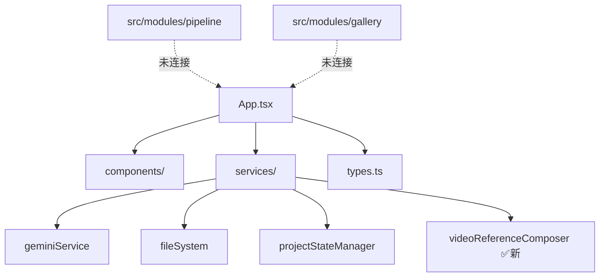

# 🚀 V3 架构迁移计划

## 📋 概述

本文档描述从当前 AIComicDramas4.0 架构迁移到 V3.0 架构的详细计划。采用**渐进式迁移策略**，确保在迁移过程中系统持续可用，最小化风险。

---

## 🎯 迁移目标

### 架构升级目标
- ✅ 从单体架构迁移到领域驱动设计（DDD）
- ✅ 从 IndexedDB Blob 存储迁移到 OPFS 双层存储
- ✅ 从内存队列迁移到持久化任务队列（RxDB）
- ✅ 从命令式代码迁移到响应式架构
- ✅ 提升类型安全和错误处理

### 业务目标
- ⚡ 零延迟交互体验
- 📱 Local-First 架构
- 🔄 离线优先，后台同步
- 🛡️ 数据持久化和故障恢复
- 📊 可观测性和调试能力

---

## 📊 当前状态分析

### 现有系统结构

```
/（根目录 - 正在使用的主系统）
├── App.tsx                          # 主应用（1444 行）
├── components/                      # UI 组件
│   ├── StoryboardBoard.tsx         # 分镜面板 ✅ 已添加视频参考图
│   ├── Dashboard.tsx
│   ├── ProjectManager.tsx
│   └── ...
├── services/                        # 服务层
│   ├── geminiService.ts            # AI 服务
│   ├── fileSystem.ts               # 文件系统
│   ├── projectStateManager.ts      # 项目状态管理
│   ├── videoReferenceComposer.ts   # 视频参考图 ✅ 新增
│   └── ...
├── types.ts                         # 类型定义
└── db.ts                            # IndexedDB 数据库

src/（V3.0 新架构 - 部分实现）
└── modules/
    ├── pipeline/                    # 任务管理系统 ✅ 已实现
    │   ├── domain/
    │   │   └── TaskEntity.ts       # 任务实体
    │   ├── infrastructure/
    │   │   ├── TaskRepository.ts   # 持久化
    │   │   └── TaskQueue.ts        # 任务队列
    │   └── README.md
    ├── gallery/                     # 资产管理 🚧 部分实现
    │   ├── domain/
    │   │   └── Asset.ts
    │   └── presentation/
    └── shared/                      # 共享基础设施
        ├── infrastructure/
        │   ├── db/database.ts      # RxDB 配置
        │   └── storage/opfs-service.ts
        └── ...
```

### 依赖关系分析



**问题**：
- ❌ V3 模块与主应用未集成
- ❌ 两套并行的类型定义系统
- ❌ 缺少桥接层连接新旧系统

---

## 🔄 迁移策略：渐进式混合架构

### 核心理念
> **不做大爆炸式重写，而是建立桥接层，让新旧系统共存并逐步替换**

### 四阶段迁移路线图

```
Phase 1: 准备阶段 ━━━> Phase 2: 共存阶段 ━━━> Phase 3: 迁移阶段 ━━━> Phase 4: 完成阶段
(1 周)              (2-3 周)              (3-4 周)              (1 周)
```

---

## 📅 详细实施计划

### Phase 1: 准备阶段（第 1 周）✅ 进行中

**目标**：建立桥接层，使两个系统可以互通

#### 1.1 创建桥接层 ✅ 已完成
- [x] `bridge/LegacyAdapter.ts` - 类型适配器
- [x] `bridge/TaskBridge.ts` - 任务系统桥接
- [x] `bridge/index.ts` - 统一导出

#### 1.2 功能开关系统 ✅ 已完成
- [x] `config.ts` - 功能开关配置
- [x] `FeatureManager` - 功能开关管理器

#### 1.3 TypeScript 配置
- [ ] 配置 `tsconfig.json` 路径映射
  ```json
  {
    "compilerOptions": {
      "paths": {
        "@v3/*": ["src/*"],
        "@legacy/*": ["./*"],
        "@bridge/*": ["bridge/*"]
      }
    }
  }
  ```

#### 1.4 文档完善
- [x] `MIGRATION.md` - 迁移计划
- [ ] `BRIDGE_GUIDE.md` - 桥接层使用指南
- [ ] 更新 `CLAUDE.md` 记录变更

**验收标准**：
- ✅ 桥接层可以在新旧系统间转换数据
- ✅ 功能开关系统可以控制特性启用/禁用
- ✅ npm run build 无错误

---

### Phase 2: 共存阶段（第 2-3 周）🎯 下一步

**目标**：让 V3 功能与旧系统并存，优先迁移低风险模块

#### 2.1 集成视频参考图到 V3（第 2 周第 1-2 天）

**当前状态**：
- ✅ `services/videoReferenceComposer.ts` 已在根目录实现
- ✅ `StoryboardBoard.tsx` 已集成功能

**迁移步骤**：
1. 创建 V3 版本
   ```typescript
   // src/modules/video/application/ComposeVideoReferenceUseCase.ts
   // src/modules/video/domain/VideoReferenceFrame.ts
   // src/modules/video/infrastructure/VideoReferenceRepository.ts
   ```

2. 在 `StoryboardBoard.tsx` 中通过功能开关切换
   ```typescript
   import { FEATURES } from '../config';
   import { composeVideoReference as legacyCompose } from '../services/videoReferenceComposer';
   import { ComposeVideoReferenceUseCase } from '../src/modules/video/application/ComposeVideoReferenceUseCase';
   
   const composer = FEATURES.USE_V3_VIDEO_REFERENCE 
     ? new ComposeVideoReferenceUseCase(...)
     : legacyCompose;
   ```

3. 测试双版本
   - 关闭开关：使用旧版本
   - 开启开关：使用 V3 版本
   - 验证功能一致性

**验收标准**：
- ✅ V3 版本功能与旧版本等效
- ✅ 可通过功能开关切换
- ✅ 无性能退化

#### 2.2 迁移任务管理系统（第 2 周第 3-5 天）

**目标**：将 `projectStateManager.ts` 中的任务管理逐步迁移到 `TaskQueue`

**步骤**：
1. 在 `App.tsx` 中初始化 TaskBridge
   ```typescript
   import { TaskBridge } from './bridge/TaskBridge';
   import { FEATURES } from './config';
   
   const taskBridge = new TaskBridge({
     useV3System: FEATURES.USE_V3_TASK_SYSTEM,
     enableSync: FEATURES.ENABLE_LEGACY_SYNC,
     debugMode: FEATURES.DEBUG_V3_MIGRATION,
     legacyTaskService: projectStateManager,
     v3TaskQueue: taskQueue,  // 从 RxDB 初始化
   });
   ```

2. 替换任务创建逻辑
   ```typescript
   // 旧代码
   const taskId = await projectStateManager.createTask({ type: 'image', ... });
   
   // 新代码（通过桥接）
   const taskId = await taskBridge.createTask({ type: 'image', params: {...} });
   ```

3. 逐步替换任务查询和操作
   - `getTaskStatus()` → `taskBridge.getTaskStatus()`
   - `getPendingTasks()` → `taskBridge.getPendingTasks()`
   - `cancelTask()` → `taskBridge.cancelTask()`

**验收标准**：
- ✅ 功能开关关闭时使用旧系统
- ✅ 功能开关开启时使用 V3 系统
- ✅ 双系统同步正常

#### 2.3 迁移资产管理（第 3 周）

**步骤**：
1. 完善 `src/modules/gallery/` 模块
2. 实现 Gallery 与旧 Asset 系统的适配器
3. 在 `AssetLibrary.tsx` 中集成 V3 Gallery

**优先级**：中等（可与任务系统并行）

---

### Phase 3: 迁移阶段（第 4-7 周）

**目标**：大规模迁移核心业务逻辑到 V3

#### 3.1 存储层迁移
- [ ] 从 IndexedDB Blob 迁移到 OPFS
- [ ] 数据迁移工具
- [ ] 存储空间管理

#### 3.2 状态管理迁移
- [ ] 从 React State 迁移到 Zustand + RxDB
- [ ] 响应式数据流
- [ ] 乐观 UI 更新

#### 3.3 核心业务逻辑迁移
- [ ] 项目管理
- [ ] 脚本编辑
- [ ] 分镜生成

---

### Phase 4: 完成阶段（第 8 周）

**目标**：移除旧系统代码，清理桥接层

#### 4.1 代码清理
- [ ] 删除旧的 `services/` 目录
- [ ] 删除 `bridge/` 目录（不再需要）
- [ ] 合并 `types.ts` 到 `src/shared/types.ts`

#### 4.2 性能优化
- [ ] 启用 SharedWorker
- [ ] 优化 RxDB 索引
- [ ] OPFS 缓存策略

#### 4.3 文档完善
- [ ] 更新架构文档
- [ ] 编写开发指南
- [ ] 更新 README

---

## 🔧 技术细节

### 桥接层使用示例

#### 示例 1：任务创建

```typescript
// 旧代码
const task = await projectStateManager.createTask({
  type: 'image',
  source: 'gemini',
  model: 'flux',
});

// 使用桥接层（支持新旧系统）
import { TaskBridge } from './bridge/TaskBridge';

const bridge = new TaskBridge({ 
  useV3System: FEATURES.USE_V3_TASK_SYSTEM 
});

const taskId = await bridge.createTask({
  type: 'image',
  params: { source: 'gemini', model: 'flux' },
  priority: 50,
});
```

#### 示例 2：功能开关控制

```typescript
import { FeatureManager } from './config';

// 检查功能
if (FeatureManager.isEnabled('USE_V3_VIDEO_REFERENCE')) {
  // 使用 V3 版本
} else {
  // 使用旧版本
}

// 启用功能
FeatureManager.enable('USE_V3_TASK_SYSTEM');

// 根据迁移阶段自动配置
FeatureManager.configureForPhase('coexistence');
```

#### 示例 3：数据同步验证

```typescript
// 验证双系统数据一致性
const validation = await taskBridge.validateSync();

if (!validation.consistent) {
  console.error('Data inconsistency detected:', validation.differences);
}
```

---

## 📊 风险管理

### 风险识别

| 风险 | 影响 | 概率 | 缓解策略 |
|------|------|------|----------|
| 数据丢失 | 🔴 高 | 🟡 中 | 双系统同步 + 备份机制 |
| 性能退化 | 🟡 中 | 🟢 低 | 性能监控 + 回滚机制 |
| 功能不一致 | 🟡 中 | 🟡 中 | 自动化测试 + 人工验证 |
| 迁移时间超期 | 🟡 中 | 🟡 中 | 阶段性交付 + 灵活调整 |

### 回滚策略

```typescript
// config.ts 中配置回滚阈值
export const MIGRATION = {
  ENABLE_ROLLBACK: true,
  ROLLBACK_THRESHOLD: 0.1,  // 10% 错误率触发回滚
};

// 监控错误率并自动回滚
if (errorRate > MIGRATION.ROLLBACK_THRESHOLD) {
  FeatureManager.disable('USE_V3_TASK_SYSTEM');
  console.error('Auto-rollback triggered due to high error rate');
}
```

---

## ✅ 验收标准

### Phase 1 验收
- [x] 桥接层创建完成
- [x] 功能开关系统可用
- [ ] TypeScript 编译无错误
- [ ] 文档完善

### Phase 2 验收
- [ ] 至少 1 个模块完成迁移（视频参考图）
- [ ] 功能开关可控制新旧版本
- [ ] 双系统同步正常
- [ ] 无数据丢失

### Phase 3 验收
- [ ] 核心功能全部迁移
- [ ] V3 系统作为主系统
- [ ] 性能达到或超过旧系统
- [ ] 完整测试覆盖

### Phase 4 验收
- [ ] 旧代码清理完成
- [ ] 文档更新完成
- [ ] 生产环境稳定运行 1 周
- [ ] 用户反馈良好

---

## 📈 进度追踪

### 当前进度（2024-07-30）

```
Phase 1: ████████░░ 80% 完成
  - 桥接层: ✅ 100%
  - 功能开关: ✅ 100%
  - TypeScript 配置: ⏳ 0%
  - 文档: ⏳ 60%

Phase 2: ░░░░░░░░░░ 0% 未开始
Phase 3: ░░░░░░░░░░ 0% 未开始
Phase 4: ░░░░░░░░░░ 0% 未开始

总体进度: ██░░░░░░░░ 20%
```

### 下一步行动（本周）
1. ✅ 完成 TypeScript 路径配置
2. ✅ 更新 CLAUDE.md
3. 🎯 开始 Phase 2：迁移视频参考图到 V3
4. 🎯 测试任务桥接功能

---

## 🤝 团队协作

### 分工建议
- **后端/架构**：实现 TaskQueue、RxDB、OPFS
- **前端/UI**：集成桥接层到组件
- **测试/QA**：编写自动化测试、验证数据一致性
- **DevOps**：监控、日志、性能分析

### 沟通机制
- 每周同步迁移进度
- 每个 Phase 结束后进行回顾
- 遇到阻塞及时升级讨论

---

## 📚 参考资料

- [V3.0 架构文档](./ARCHITECTURE.md)
- [TaskEntity 设计文档](./src/modules/pipeline/README.md)
- [视频参考图指南](./VIDEO_REFERENCE_GUIDE.md)
- [Cursor Rules](./.cursorrules)

---

## 🎉 总结

采用**渐进式迁移**策略，我们可以：
- ✅ 保持系统持续可用
- ✅ 最小化风险
- ✅ 灵活调整优先级
- ✅ 及时获得反馈

**关键成功因素**：
1. 🔗 **桥接层**：让新旧系统无缝协作
2. 🎛️ **功能开关**：灵活控制迁移节奏
3. 🔄 **双系统同步**：保证数据一致性
4. 📊 **监控和回滚**：快速响应问题

---

*最后更新：2024-07-30*

