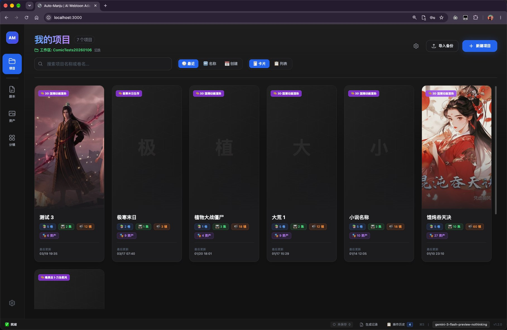
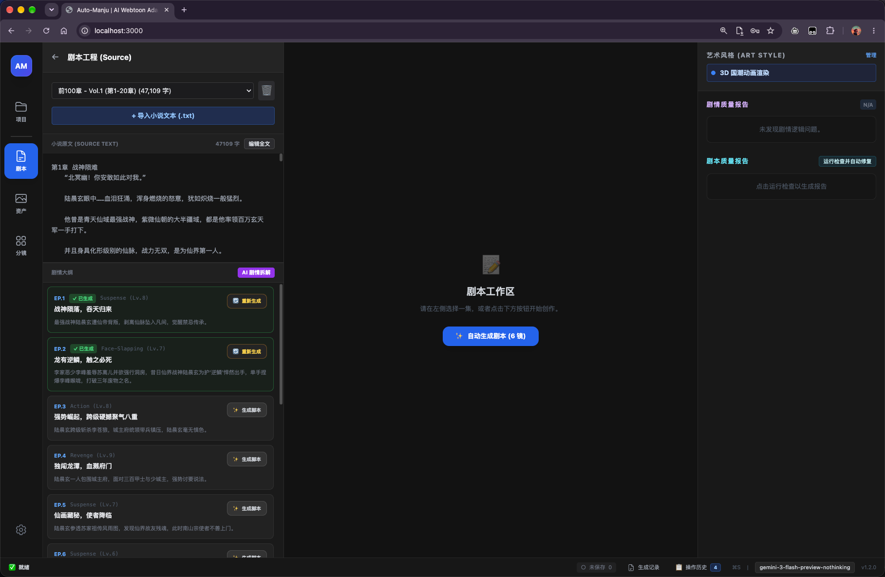
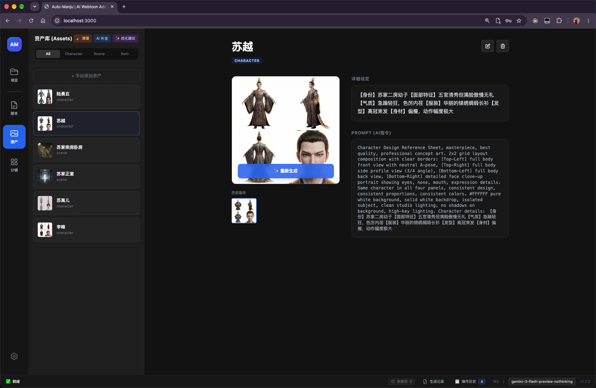
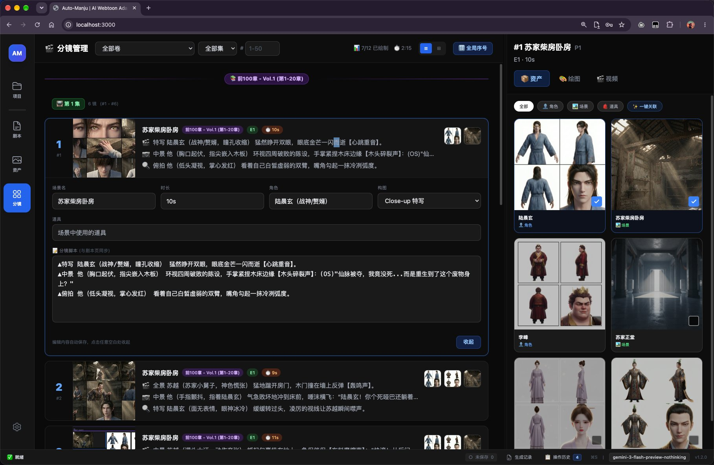
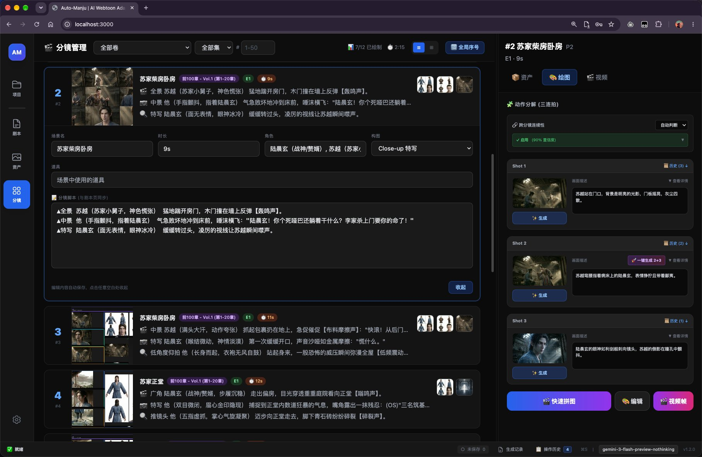

<div align="center">

# Panelix

**把一部网文，自动变成可以直接开拍的分镜脚本。**

从小说原文到剧情拆解、分镜编写、角色设定、AI 出图的完整生产流水线 —— 全部跑在浏览器里，数据不出本机。




</div>

---

## 这是什么

写漫剧/短剧最耗时的从来不是"想故事"，而是把故事**拆成一条条可执行的镜头**：这一集怎么切、钩子留在哪、每个分镜几秒、人物长什么样、这张图怎么生成。

Panelix 把这套流程做成了流水线。你只管导入小说原文，剩下的事它按顺序做完，并且**每一步都能人工介入修改**——它更像一个工作台，而不是一个黑箱。

## 界面导览

### ① 剧本工程 —— 原文进，大纲出

导入 `.txt` 原文，自动按"冲突密度"重新切集。每一集都给出钩子类型（Suspense / Face-Slapping / Action / Revenge / Romance）和强度评分，右侧实时显示剧情质量报告。



### ② 资产库 —— 角色设定与 AI 指令

从剧本里自动提取人物、场景、道具，生成**四视图角色设定板**（正面 / 侧面 / 背面 / 面部特写），并同步产出可直接投喂给绘图模型的英文 PROMPT。支持历史版本回滚。



### ③ 分镜管理 —— 三拍子脚本 + 资产联动

每个分镜严格三行：铺垫 → 冲突 → 结果。场景、时长、出场角色、构图景别一目了然，右侧一键关联对应的人物与场景资产。



### ④ 动作分解 —— 一个分镜拆成三连拍

分镜可以继续往下拆成 Shot 1/2/3，自动做**连贯性诊断**（比如"苏越跑向门口"与"背景是床"冲突，会直接提示），并支持拼图预览与直接转视频。



## 流水线

```
小说原文 (.txt)
   │
   ├─ ① 剧情拆解      Plot Splitter        按冲突密度重切集数，每集留强钩子
   ├─ ② 拆解质检      Breakdown Aligner     校验冲突强度 / 钩子密度 / 压缩合理性
   ├─ ③ 分镜编写      Writer                沉浸式四段句法，自动估算镜头时长
   ├─ ④ 剧本质检      Script Aligner        格式合规 + 画面冲击 + 跨集连贯，可自动修复
   ├─ ⑤ 资产提取      Asset Extractor       人物 / 场景 / 道具 → 英文绘图提示词
   ├─ ⑥ 出图 / 出视频  Image & Video         Gemini 图像 · 火山方舟 Seedance
   └─ ⑦ 归档          Archivist             更新 Story Bible，维护角色状态
```

## 核心特性

- **三拍子分镜语法** — 每个分镜强制 3 行（铺垫 → 冲突 → 结果），每行以 `▲` 起头，按"运镜 / 主语+视觉钩子 / 动作+音效 / 台词"四槽位书写，杜绝写成散文
- **自动时长估算** — 按动作数量、台词字数、节奏类型算出 8–15s 的合理时长，不用手填
- **质检 + 自动修复** — Aligner 不只报错，直接给出**可替换的完整三行文本**，一键采纳
- **跨集连贯性保护** — 本集第一个分镜必须承接上一集结尾钩子，不允许突兀跳场
- **角色一致性** — 四视图设定板 + 固定描述锚点，保证同一角色在不同镜头里不"换脸"
- **纯本地存储** — 元数据走 RxDB，图片音频走 OPFS，关掉网页数据也还在
- **导入导出** — 整个项目打包成 ZIP，换台机器接着做

## 技术栈

| 层 | 选型 |
|---|---|
| 前端 | React 19 · TypeScript 5.8 · Vite 6 |
| 存储 | RxDB + Dexie（元数据）· OPFS（二进制资产） |
| AI | Google Gemini（文本 / 图像）· 火山方舟 Ark（Seedance 视频） |
| 本地后端 | Python FastAPI（ffmpeg 拼接 + 火山 API 跨域代理） |

## 快速开始

### 前端

```bash
npm install

# 生成本地配置（含 API Key，不会被提交）
cp config.example.json config.json

npm run dev
```

打开 http://localhost:3000 ，在 **设置** 中填入：

| 字段 | 说明 |
|---|---|
| API Key | 任意 OpenAI 兼容接口的密钥 |
| API Base URL | 对应服务地址 |
| 火山方舟 API Key | 仅生成视频时需要 |

### 本地后端（可选）

用于视频拼接和火山 API 代理：

```bash
cd python_backend
python3 -m venv .venv && source .venv/bin/activate
pip install -r requirements.txt
python main.py     # 127.0.0.1:8008
```

需要系统已安装 `ffmpeg`（macOS: `brew install ffmpeg`）。

| 接口 | 用途 |
|---|---|
| `GET  /api/health` | 健康检查 |
| `POST /api/concat` | 多段视频拼接 |
| `POST /api/volc/video/create` | 火山视频任务创建 |
| `GET  /api/volc/video/query/*` | 火山任务查询 |
| `POST /api/volc/image/generate` | 火山图像生成 |

## 目录结构

```
├── App.tsx                 # 主应用
├── src/                    # V3 架构（DDD：modules / shared）
├── components/             # UI 组件（分镜板、资产库、设置…）
├── services/               # AI Agent、文件系统、ZIP、配置
├── bridge/                 # 新旧任务系统桥接层
├── python_backend/         # FastAPI 本地服务
├── docs/images/            # 截图
├── config.example.json     # 配置模板（无密钥）
└── CLAUDE.md               # 开发日志 / Memory Bank
```

## 安全说明

- `config.json` 已加入 `.gitignore`，**你的 API Key 不会被提交**
- 仓库只保留 `config.example.json`，密钥字段为空
- 所有数据默认存在浏览器本地，不上传任何服务器

## 文档

| 文件 | 内容 |
|---|---|
| [ARCHITECTURE.md](ARCHITECTURE.md) | V3 架构规则与设计原则 |
| [项目工作流程.md](项目工作流程.md) | 完整生产流程 |
| [SHOT_SCHEMA_GUIDE.md](SHOT_SCHEMA_GUIDE.md) | 分镜数据结构 |
| [QUICKSTART.md](QUICKSTART.md) | 桥接层与功能开关 |
| [BRIDGE_GUIDE.md](BRIDGE_GUIDE.md) | 桥接层详细用法 |
| [MIGRATION.md](MIGRATION.md) | 架构迁移计划 |

## License

本项目采用 [MIT License](LICENSE) 开源，可自由使用、修改与商用，保留版权声明即可。

Copyright (c) 2026 zjzforfb-jpg
